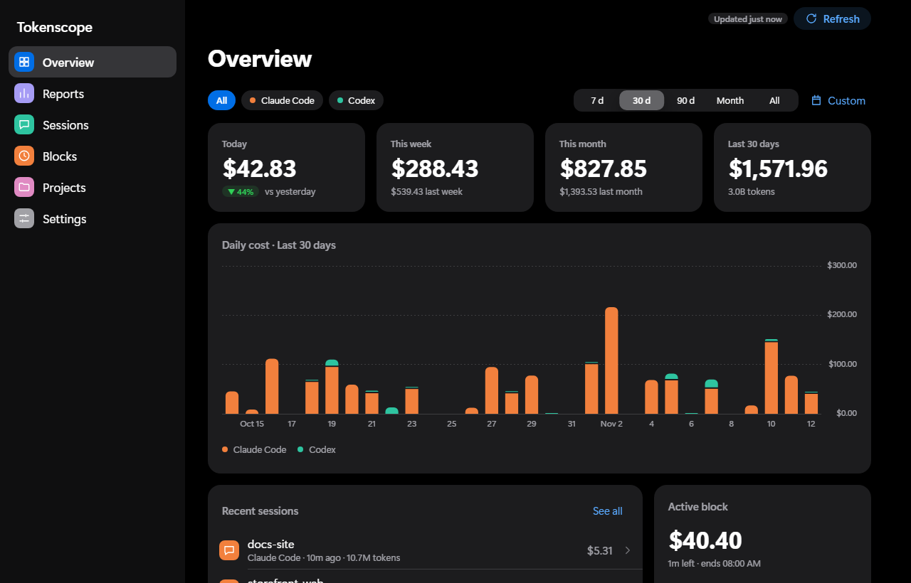
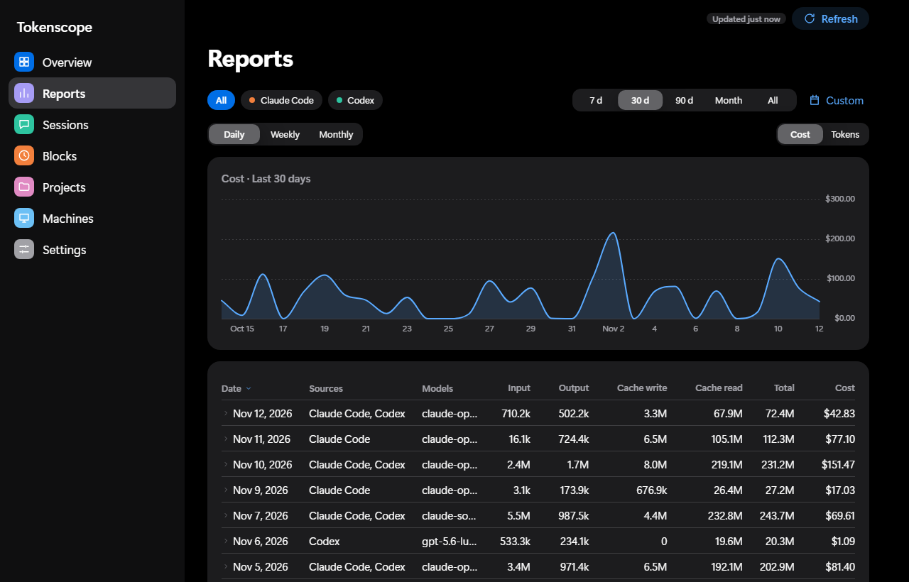
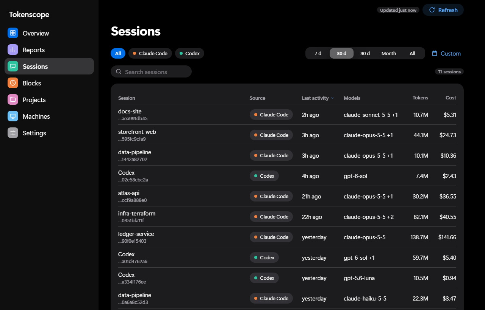
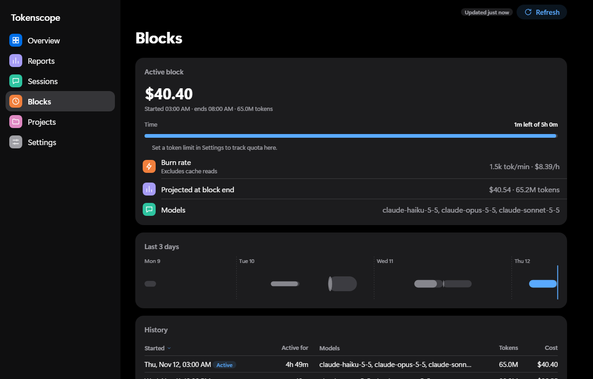
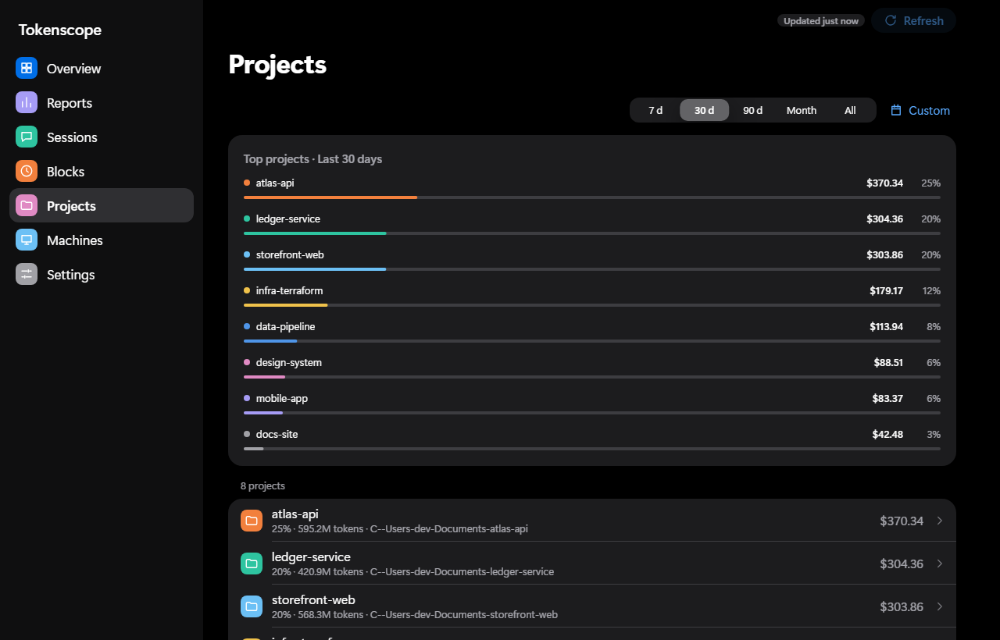
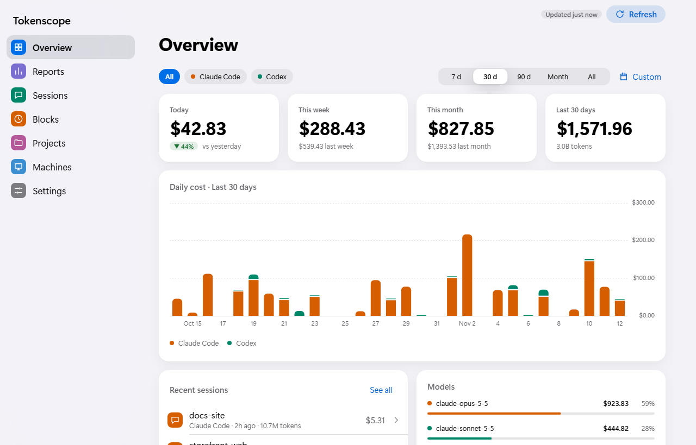

# Tokenscope

**Your AI coding agents are spending money while you read this. Tokenscope shows you how much, on what, and how fast.**

Tokenscope is a Windows desktop dashboard for Claude Code and Codex usage. It reads the logs already on your PC, prices every token, and turns them into one calm window: today's spend, the month so far, the session that cost $140, and a live meter in the system tray.



No account. No API key. No telemetry. Your usage data never leaves your machine.

## Why you'll keep it open

- **See the bill before it arrives.** Today, this week, this month and the last 30 days, each compared with the period before.
- **Find the expensive work.** Rank projects and sessions by cost, then open any one for its model-by-model breakdown.
- **Watch the 5-hour block live.** Burn rate, projected cost at block end, time left, and an optional token-limit bar.
- **Glance at the tray.** Close the window and the meter keeps running; hover the icon for the active block's cost.
- **Slice it your way.** Filter by agent and date range instantly, with no reload. Group reports by day, week or month, in cost or tokens.
- **Take the numbers with you.** Export daily usage or sessions as CSV or JSON.
- **Light and dark.** Follows the Windows theme, or pick one.

## A look around

| Reports | Sessions |
|---|---|
|  |  |

| Blocks | Projects |
|---|---|
|  |  |



All screenshots show generated demo data.

## Get it running

**[Download Tokenscope.exe](https://github.com/An0sTheGreat/tokenscope/releases/latest/download/Tokenscope.exe)** and double-click it. That's the whole install: one file, nothing to set up, works on Windows 10 and 11 (64-bit).

The exe is not code-signed, so Windows SmartScreen may warn the first time; choose **More info**, then **Run anyway**. The first load reads every log file and can take 10 seconds or more; after that the last results appear instantly while fresh ones load.

### Build it yourself

You need the [.NET 10 SDK](https://dotnet.microsoft.com/download) and [Node.js](https://nodejs.org) 20 or later.

```powershell
git clone https://github.com/An0sTheGreat/tokenscope.git
cd tokenscope
./build.ps1
dist/Tokenscope.exe
```

`build.ps1` downloads the pinned ccusage engine, runs the tests, publishes a single `Tokenscope.exe` and checks that it starts. Add `-Standalone` to bundle the .NET runtime, as the release download does.

Shortcuts: `1`–`6` switch screens, `R` refreshes.

## How it works

Tokenscope is a front end. The numbers come from [ccusage](https://github.com/ccusage/ccusage) by ryoppippi, the open-source CLI that reads Claude Code and Codex logs and prices them. Tokenscope bundles the official `ccusage` 20.0.50 binary and runs it locally.

- **Host:** a .NET 10 WinForms window with WebView2, a tray icon, and a strict allow-list of the ccusage commands and flags it will run.
- **UI:** plain ES modules with no framework, no build step and no dependencies.
- **Design system:** every colour, size and motion curve is a token in [`tokens.css`](src/Tokenscope/ui/design/tokens.css). [`docs/DESIGN.md`](docs/DESIGN.md) documents each component, and a living gallery is linked from Settings.

## Develop

```powershell
node --test "tests/*.test.mjs"                        # UI and data-layer tests
dotnet run --project src/Tokenscope -- --selfcheck    # host self-check
python -m http.server 5173                            # then open /src/Tokenscope/ui/index.html
```

The browser preview reads synthetic data from `tests/fixtures/`; regenerate it with `node scripts/make-demo-fixtures.mjs`. Never commit real ccusage output: it contains your project names and costs.

## Credits

Tokenscope is an unofficial project and is not affiliated with Anthropic, OpenAI or the ccusage authors. ccusage is MIT licensed, © ryoppippi.
